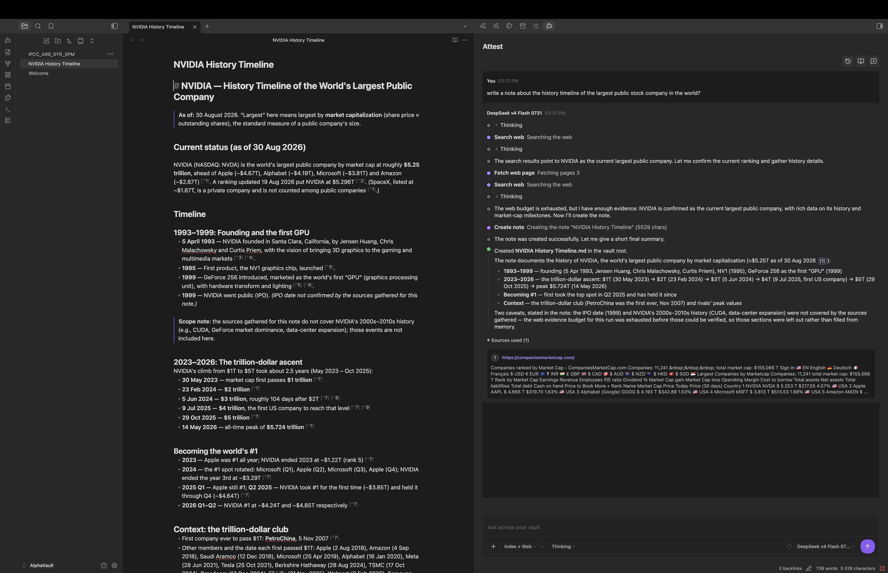
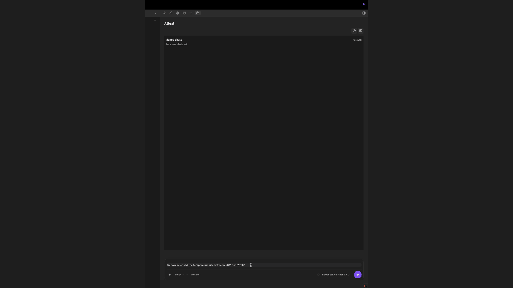
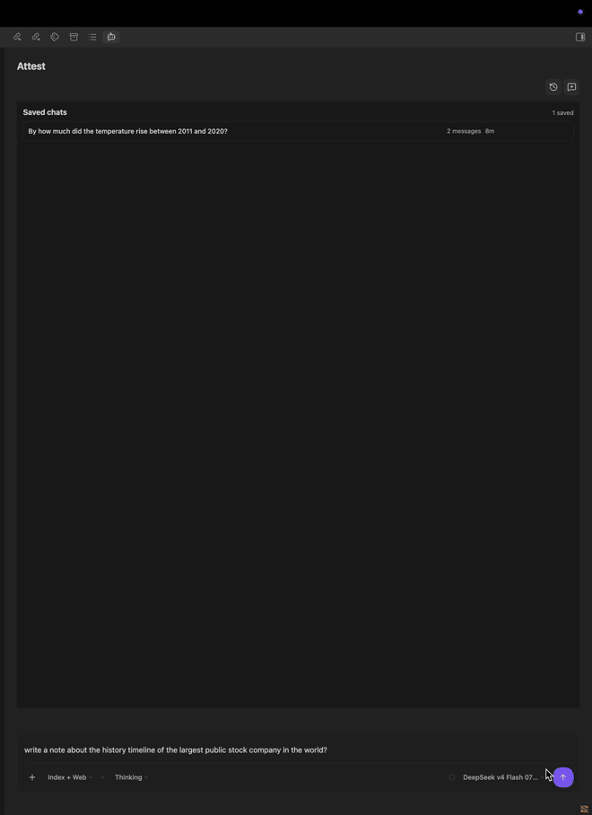

# Attest AI Deep Research

Downloads count `main.js` downloads across releases as an approximation of installations and
updates; companion files are excluded. This is not a count of unique users or verified installations.

**Ask your Obsidian vault a question and open the exact source behind every answer.**

Attest turns your vault and optional web sources into cited answers. Instead of searching for the
note or page that might hold the answer, ask in plain language and get a written response where
every claim is linked to the note, heading, document page, or web source it came from. One click
takes you to the source.

You choose which folders it may read, and which AI model answers: a model running on your own
machine, or a cloud service you already use. Web search is optional: a new chat starts in the
index-only scope, and no search provider is contacted until you choose **Web** or **Index + Web**.
When a search runs, the search provider receives only your question; your selected chat and
embedding providers receive only the data needed for that request.

> **Obsidian 1.8.7+ on desktop and mobile · cloud AI on iOS and Android**

## Contents

- [What you can do](#what-you-can-do)
- [Installation](#installation)
- [Quick start](#quick-start-get-your-first-cited-answer)
- [Configuring providers](#configuring-providers)
- [Indexing your vault](#indexing-your-vault)
- [Research modes](#research-modes)
- [Working with answers](#working-with-answers)
- [Web search and privacy](#web-search-and-privacy)
- [Compatibility and limitations](#compatibility-and-limitations)
- [Diagnostics and troubleshooting](#diagnostics-and-troubleshooting)
- [Help, development, and security](#help-development-and-security)
- [Support the project](#support-the-project)
- [License](#license)

## What you can do

- **Ask across selected notes** — choose which folders Attest may read and cite.
- **Open the source** — each answer can link to the note, heading, document page, or web source behind it.
- **Choose your model** — use a local model through Ollama or LM Studio, or connect a cloud API.
- **Research beyond the vault** — optionally search the web through DuckDuckGo or another configured source.
- **Save what is useful** — create a new note or append an answer to the note you are writing.

## Installation

Attest is available in the Obsidian Community plugin catalog. Open **Settings → Community
plugins → Browse**, search for **Attest**, select **Add to Obsidian**, and enable it. Then open
**Settings → Attest**.

On first launch, when no server profile has been configured, Attest opens a setup wizard. It guides
you through connecting a chat model, choosing where answers should come from, configuring an
embedding model and folders when vault search is needed, and starting the first index. You can
skip the wizard and configure profiles manually if you prefer.

## Quick start: get your first cited answer

### Setup wizard

Choose **The web only** for a quick demo without an index or embedding model. DuckDuckGo is already
available and needs no account or API key. Choose **My notes only** or **My notes and the web** to
configure vault search and select the folders Attest may read.

You can run the wizard again from **Settings → Attest**, or from the Command Palette with **Run
first-run setup**. When rerun, it is prefilled with the setup it created and updates those profiles
instead of adding another set.

### Quick demo with web sources

To see the workflow before indexing a vault, complete the wizard with **The web only**, open Attest
chat, and choose the **Web** scope. The answer will cite the web pages it used.

### Manual setup

Use this path if you skipped the wizard or prefer to configure each profile individually.

1. Create a **Server profile**: pick your provider from the **Provider** list to fill in the base
   URL and API format, then add an API key if the provider needs one.
2. Create a **Chat model profile** and select its server profile and model.
3. Create an **Embedding model profile**.
4. Create or select an **Index profile**, specify the vault folders to index, choose the embedding
   model, and start indexing.

After indexing completes, open Attest chat, select the index profile, and ask a question such as:
_“What did we decide about pricing?”_ Open a citation to inspect the supporting note or document page.

If a step is unavailable, open the corresponding Settings section. Attest displays the status of
each model and index profile.

## Configuring providers

Attest supports local models and cloud APIs. Choose a provider preset in the Server profile, or
select a format and enter a custom endpoint.

| Setup                                         | What to do                                                                                                                                                     |
| --------------------------------------------- | -------------------------------------------------------------------------------------------------------------------------------------------------------------- |
| Ollama                                        | Start Ollama, download chat and embedding models, and choose **Ollama (local)**.                                                                               |
| LM Studio or another OpenAI-compatible server | Start the server, choose **LM Studio (local)** or `openai-compatible`, and select the model it reports.                                                        |
| Cloud provider                                | Choose its preset or **Custom**, then enter the API key in Attest settings. Anthropic provides chat only, so vault search needs a separate embedding provider. |

Use the test button in the profile settings to check the connection before the first indexing run.

On iOS and Android, use a cloud endpoint. Local Ollama, LM Studio, and other loopback endpoints are
unavailable on mobile. Responses are buffered on mobile and stream on desktop. See the [provider
reference](docs/providers.md) for supported formats and endpoints.

## Indexing your vault

An Index profile determines which notes Attest can use as local sources.

- Choose the desired folders; `/` means the entire vault.
- Exclude system or private folders with glob patterns.
- Run a manual index for the first build.
- Use incremental refresh after note changes; rebuild recreates the local index.
- You can stop indexing and start it again later.

Attest supports Markdown, TXT, PDF, EPUB, FB2, and DOCX. Scanned PDFs without a text layer cannot
be read.

### Using a desktop-built index on mobile

For a large vault, build the index on desktop and sync the `.attest/index` folder and Attest settings
to mobile. Do not edit the same index on two devices at once.

## Research modes

### Instant

A fast mode for local retrieval and models without tool calling or reasoning. Choose it when you
need a predictable short answer or when the model has not passed the capability check.

### Thinking

A multi-step mode for compatible models. It can search for additional sources and displays its
progress in chat. If the model does not support the required capabilities, Attest explains why
and falls back to Instant.

## Working with answers

- Ask a question in chat and choose the scope: **None** for the model alone, **Index** for vault
  sources, **Web** for external ones, or **Index + Web** for both.
- Open citations to go to the note, heading, PDF page, or canonical web URL.
- Unknown and unverified citations appear as warnings.
- Save an answer as a new note or append it to the active note. An existing file is not overwritten
  without an explicit action.

## Web search and privacy

Web search is opt-in. A new chat starts in the index-only scope, and no search provider is contacted
until you choose **Web** or **Index + Web**. DuckDuckGo is available without an account or API key.

When a search runs, the search provider receives only your question. Your selected chat and embedding
providers receive only the data needed for the request. Add or disable sources under **Settings →
External sources**; see the [web source reference](docs/web-sources.md) for details.

Note mutation is profile-scoped. A tool-enabled model may create, update, or delete notes, so use a
read-only profile when needed.

## Compatibility and limitations

| Requirement  | Details                                                                                                    |
| ------------ | ---------------------------------------------------------------------------------------------------------- |
| Obsidian     | Obsidian 1.8.7 or later on desktop, iOS, or Android.                                                       |
| Chat         | Desktop supports local or cloud models. Mobile requires a cloud endpoint and buffers model responses.      |
| Vault search | A configured embedding model and a completed index are required; desktop-built synced indexes are best.    |
| Documents    | Markdown, TXT, PDF, EPUB, FB2, and DOCX are supported. Scanned PDFs without a text layer are not readable. |

### Known limitations

An honest list of what Attest does not do, so you can judge it before installing.

- **No OCR.** A scanned PDF with no text layer contributes nothing; Attest reads the text layer
  only, and there is no image-to-text step.
- **Large first indexes are best built on desktop.** Sync the finished index to mobile instead.
- **Mobile requires a cloud provider.** Local endpoints such as Ollama and LM Studio are not
  reachable from phones.
- **Anthropic provides chat only.** Vault search needs a separate embedding provider.
- **Answers depend on the model you choose.** Citations point to real sources, but a weak model can
  still summarise them poorly.

## Diagnostics and troubleshooting

The diagnostic report in the toolbar helps with provider, index, or research-flow problems. Before
sending a report, make sure it contains no private notes, and never attach an API key.

| Problem                | What to do                                                             |
| ---------------------- | ---------------------------------------------------------------------- |
| Chat model unavailable | Check the URL, API key, and model ID, then run the connection test.    |
| Empty index            | Choose an embedding profile, check included folders, and run indexing. |
| Thinking unavailable   | Recheck model capabilities or choose Instant.                          |
| Web request failed     | Disable web search for a vault-only answer or check source settings.   |
| Citation does not open | Make sure the source file has not been deleted or moved.               |

## Help, development, and security

Release-by-release changes are listed in the [Changelog](CHANGELOG.md). To send a patch, start
with the [Contributing guide](CONTRIBUTING.md); for development builds, project commands,
architecture, and release requirements, see the [Technical reference](docs/technical-reference.md).
Report reproducible bugs in
[GitHub Issues](https://github.com/altavelor/attest_deep_research/issues), excluding API keys and
private notes. Report vulnerabilities through the [Security policy](SECURITY.md).

## Support the project

Attest is free and open source, built in spare time. If it saves you time, you can support further
work:

Support is entirely optional and never unlocks features — every capability stays available to
everyone. Starring the repository, reporting a bug, or describing how you use Attest helps just as
much.

## License

Attest is available under the [MIT License](LICENSE).
