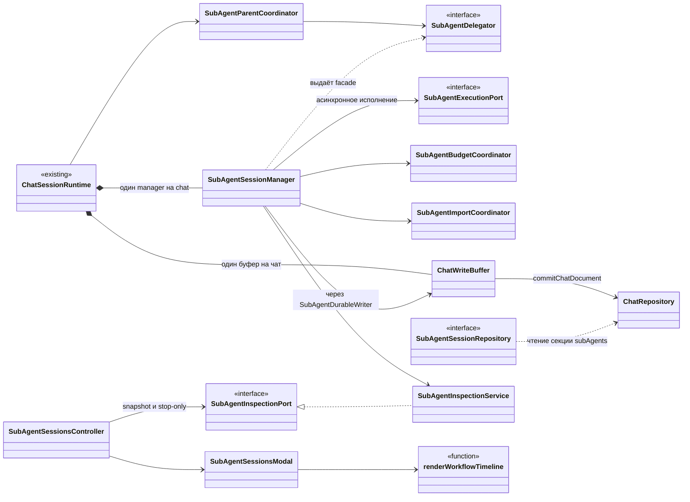

# UML дочерних агентов

Целевая архитектура по [управляющей спецификации](sub-agent-sessions-spec.md) и десяти шагам.
Это диаграммы планируемых компонентов; наличие класса на схеме не означает его реализацию.
Новые concrete classes, интерфейсы, функции, DTO/union и существующие компоненты различены
стереотипами. Детальные схемы содержат все именованные новые сущности текущего комплекта.

| Схема                                                                     | Содержание                                                                |
| ------------------------------------------------------------------------- | ------------------------------------------------------------------------- |
| [1. Классы исполнения](sub-agent-sessions-uml/01-runtime.md)              | Владение, фабрика, facade, порты, импорты, бюджеты, writer                |
| [2. Доменные объекты](sub-agent-sessions-uml/02-domain.md)                | Session/run, команды, receipt/result, evidence и usage                    |
| [3. Права и хранение](sub-agent-sessions-uml/03-storage-budget.md)        | Bindings/epochs/grants, state, deltas, permits и recovery                 |
| [4. Наблюдение и UI](sub-agent-sessions-uml/04-inspection-ui.md)          | Modal, stop-only API, DTO, общий renderer и batch matrix                  |
| [5. Экземпляры двух чатов](sub-agent-sessions-uml/05-objects.md)          | Изоляция managers, facades, queues и состояния                            |
| [6. Асинхронное исполнение](sub-agent-sessions-uml/06-async-sequences.md) | Launch receipt, независимая работа parent, import и доставка; map_sources |
| [7. Остановка и буфер](sub-agent-sessions-uml/07-stop-buffer.md)          | expectedRunId, synchronous fence, write barriers и пороги flush           |
| [8. Required-scope budget](sub-agent-sessions-uml/08-budget-protocol.md)  | Регистрация, reserve/start/settle, denial и closure cleanup               |
| [9. Инструменты модели](sub-agent-sessions-uml/09-model-tools.md)         | Launch/get/wait и отдельное получение matrix                              |
| [Каталог покрытия](sub-agent-sessions-uml/catalog.md)                     | Именованные новые классы, порты, DTO и функции                            |

Сплошная стрелка — ассоциация/взаимодействие, пунктир — зависимость или создание,
полый треугольник — наследование/реализация; чёрный ромб — владение жизненным циклом.
Слово object означает экземпляр, DTO — объект данных, union — одну из альтернатив.
Методы в последовательностях могут описывать действие, если concrete method не закреплён
спецификацией; схемы не вводят новые API или классы исполнения.
