# UML: классы исполнения и порты

Источник: шаги 2–6, 8–10. Это целевая архитектура, а не описание реализованного main.
Стереотип existing обозначает существующий компонент с расширением контракта;
interface — порт или фабрика, new — новый класс. Ромб означает владение жизненным циклом.

```mermaid
classDiagram
  direction LR
  class ChatSessionRuntime {
    <<existing>>
    -subAgents
    +execute(request, runId)
  }
  class SubAgentSessionManagerFactory {
    <<factory>>
    +create(context) SubAgentHost
  }
  class SubAgentLifecycle {
    <<interface>>
    +closeAll(parentRunId, terminalReason)
    +dispose()
  }
  class SubAgentHost {
    <<interface>>
    +delegatorFor(binding, delivery) SubAgentDelegator
    +subscribeResults(listener)
    +listRunRefs(parentRunId)
    +inspection() SubAgentInspectionPort
  }
  class SubAgentSessionManager {
    <<new>>
    -records
    -queue
    -grants
    +delegatorFor(binding, delivery)
    +closeAll(parentRunId, terminalReason)
    +dispose()
  }
  class SubAgentDelegator {
    <<interface>>
    +create(input)
    +getCreatedSession(createRequestId)
    +run(sessionId, command, submissionId) SubAgentRunReceipt
    +continue(sessionId, command, submissionId) SubAgentRunReceipt
    +retry(sessionId, command, submissionId) SubAgentRunReceipt
    +getResult(sessionId, runId) SubAgentResultState
    +waitForResults(refs, options) SubAgentWaitResult
    +stop(sessionId)
  }
  class SubAgentParentCoordinator {
    <<new>>
    +beforeModelRound()
    +acknowledgeResults(results)
    +beforeFinalize(signal)
  }
  class SubAgentExecutionPort {
    <<interface>>
    +run(request) SubAgentExecutionResult
  }
  class SubAgentRunner {
    <<existing>>
    +run(input)
  }
  class SubAgentEvidenceImportPort {
    <<interface>>
    +commit(request) SubAgentImportResult
  }
  class SubAgentImportCoordinator {
    <<new>>
    +commit(request)
  }
  class ChatSubAgentEvidenceBridge {
    <<new>>
    +commit(request)
    +resolve(outcome)
  }
  class SubAgentImportedEvidenceResolver {
    <<interface>>
    +resolve(outcome) ResearchEvidenceSnapshot
  }
  class SubAgentBudgetCoordinator {
    <<new>>
  }
  class SubAgentBudgetPermitPort {
    <<interface>>
    +beginSessionRegistration(scopeId, creationKey)
    +finishSessionRegistration(registration, outcome)
    +beginExecution(scopeId, actionKey)
    +reserve(scopeId, request)
    +markStarted(permit)
    +settle(permit, outcome)
    +claimClosureCleanup(scopeId, closureId)
  }
  class ChatWriteBuffer {
    <<new>>
    +markDirty(key, revision, delta)
    +markChatDirty(input)
    +discard()
    +reopen()
    +resolveConflict(choice)
    +flushThrough(revision, reason)
    +dispose()
  }
  class SubAgentDurableWriter {
    <<interface>>
    +markDirty(key, revision, delta)
    +flushThrough(revision, reason)
  }
  class SubAgentSessionRepository {
    <<interface>>
    +load(chatId)
  }
  class ChatDocumentSubAgentRepository {
    <<new>>
    +load(chatId)
  }
  class ChatSubAgentBridge {
    <<new>>
  }
  class ChatRepository {
    <<existing_interface>>
    +saveChat(input)
    +loadChatDocument(id)
    +commitChatDocument(change)
  }
  class SubAgentInspectionService {
    <<new>>
    +snapshot()
    +getSession(sessionId)
    +subscribe(listener)
    +stopFromUser(sessionId, expectedRunId)
  }
  class SubAgentInspectionPort {
    <<interface>>
  }
  class MapSourcesWorkerPort {
    <<interface>>
    +runSource(input) SubAgentRunReceipt
    +getResult(ref) SubAgentResultState
  }
  class MapSourcesWorkerAdapter {
    <<new>>
    +runSource(input)
    +getResult(ref)
  }
  class MapSources {
    <<existing>>
    +start(input, requestId) MapSourcesBatchReceipt
    +getResult(batchId) MapSourcesBatchState
  }
  SubAgentLifecycle <|-- SubAgentHost
  SubAgentHost <|.. SubAgentSessionManager
  ChatSessionRuntime "1" *-- "1" SubAgentSessionManager : lifecycle owner
  ChatSessionRuntime ..> SubAgentSessionManagerFactory : вызывает один раз
  SubAgentSessionManagerFactory ..> SubAgentSessionManager : создаёт
  SubAgentSessionManager ..> SubAgentDelegator : выдаёт scoped facade
  ChatSessionRuntime --> SubAgentParentCoordinator : координация parent invocation
  SubAgentParentCoordinator --> SubAgentDelegator : команды и результаты
  SubAgentParentCoordinator --> SubAgentHost : сигналы готовности
  SubAgentSessionManager --> SubAgentExecutionPort : исполнение очереди
  SubAgentExecutionPort .. SubAgentRunner : связываются исполняющим адаптером
  SubAgentSessionManager --> SubAgentEvidenceImportPort : результат после импорта
  SubAgentEvidenceImportPort <|.. SubAgentImportCoordinator
  SubAgentEvidenceImportPort <|.. ChatSubAgentEvidenceBridge
  SubAgentImportCoordinator --> ChatSubAgentEvidenceBridge : этап chat registry
  SubAgentImportedEvidenceResolver <|.. ChatSubAgentEvidenceBridge
  ChatSubAgentEvidenceBridge --> ChatRepository : durable aliases
  SubAgentSessionManager --> SubAgentBudgetCoordinator : required scope
  SubAgentBudgetCoordinator --> SubAgentBudgetPermitPort : разрешения и списание
  ChatSessionRuntime *-- ChatWriteBuffer : один буфер на чат
  SubAgentDurableWriter <|.. ChatWriteBuffer
  SubAgentSessionManager --> SubAgentDurableWriter : pending deltas
  ChatSessionManager --> ChatWriteBuffer : markChatDirty и barrier
  ChatWriteBuffer --> ChatRepository : commitChatDocument, serial writer
  SubAgentSessionRepository <|.. ChatDocumentSubAgentRepository
  ChatDocumentSubAgentRepository --> ChatRepository : loadChat
  SubAgentImportCoordinator --> SubAgentDurableWriter : prepare и commit barriers
  ChatSessionRuntime --> ChatSubAgentBridge : dispatch sink и forwarding
  ChatSubAgentBridge --> ChatRepository : main timeline
  SubAgentSessionManager --> SubAgentInspectionService : приватные callbacks
  SubAgentInspectionPort <|.. SubAgentInspectionService
  MapSources --> MapSourcesWorkerPort : асинхронные workers
  MapSourcesWorkerPort <|.. MapSourcesWorkerAdapter
  MapSourcesWorkerAdapter --> SubAgentDelegator : тот же manager
  MapSourcesWorkerAdapter --> SubAgentImportedEvidenceResolver : checked evidence
```

Имя конкретного исполняющего адаптера SubAgentExecutionPort в спецификации пока
не закреплено; существующий SubAgentRunner сам этот новый порт не реализует.
Фабрика — тип функции, facade — отдельный объект с ограниченными правами; диаграмма
не требует вводить одноимённые concrete classes для интерфейсов.
Координатор импорта и evidence bridge показаны обеими реализациями порта, как в шаге 5;
стрелка между ними обозначает последовательные роли, а не вложенное удержание serializers.
Budget owner передаётся извне; конкретный Deep Research ledger вне этого комплекта.
