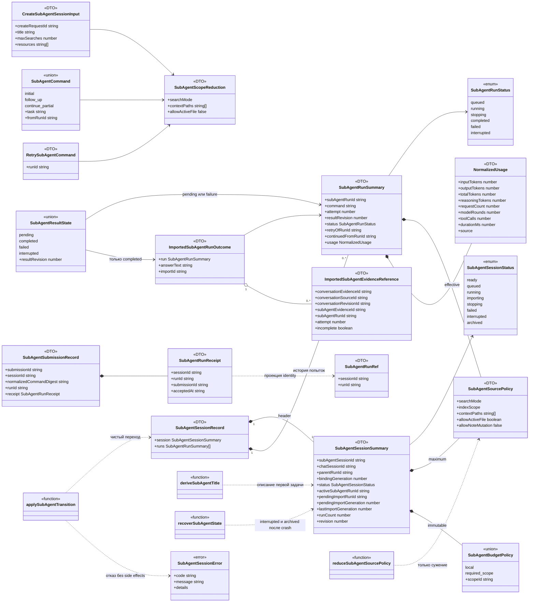

# UML: сессии, команды и результаты

Источник: шаги 1, 3, 5. DTO — объекты данных, union — альтернативные формы, enum — значения.
На схеме приведены ключевые поля; нормативный полный состав — в спецификациях.

RunReceipt подтверждает приём queued-команды; он не содержит ответа и не блокирует родителя.
RunSummary.status=completed при session=importing ещё не означает ResultState.completed.
После исчерпанного импорта session=failed при run.status=completed, pending-поля сохранены до retry,
archive или commit нового epoch.
resultRevision меняется при публикации результата, обычная revision — при обновлении состояния.
Нормативные wire discriminants содержат дефисы: follow-up, continue-partial, required-scope.
В enum-узлах они визуально записаны через подчёркивание для переносимости Mermaid.
