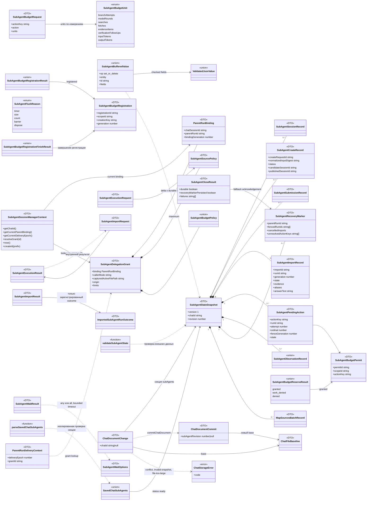

# UML: права, хранение и бюджет

Источник: шаги 2–5. Схема показывает объекты протокола и их связи; все nodes новые,
кроме явно отмеченного контекста provider/model. Поля optional/null сокращены для читаемости.

Критические записи: create/queued до receipt, начало внешнего действия, бюджетные маркеры,
terminal, stop/tombstone и import. Они требуют write barrier независимо от таймера.
Буфер содержит дочерние deltas; chat-часть и история секции subAgents не входят в его лимит 256 KiB.
Возврат full означает backpressure вне manager/chat serializer, не потерю обязательного события.
Budget registration и permit lifecycle не позволяют позднему grant возобновить остановленную работу.
