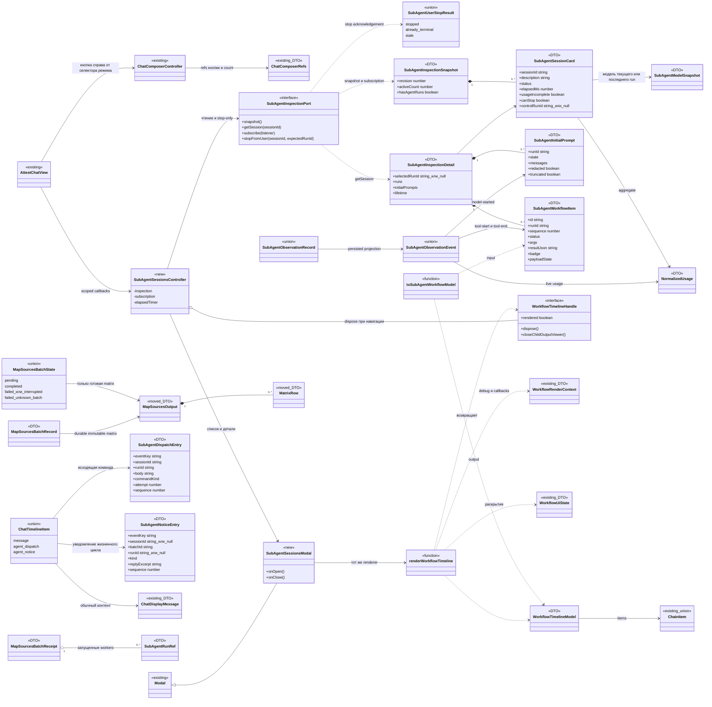

# UML: наблюдение, UI, timeline и batch-объекты

Источник: шаги 6–10. Существующие view/composer/MapSources расширяются,
renderer — функция, WorkflowTimelineHandle — объект управления ресурсами.

Без запусков hasAgentRuns=false — кнопки нет. После первого queued count=0 и серые иконка
и число; только running увеличивает счётчик и делает зелёными иконку и число, фон остаётся серым.
Modal показывает два раскрываемых раздела: initial prompt выбранного run и lifetime сессии.
В обычном режиме видны безопасные tool labels/status; In/Out доступны только в debug.
controlRunId используется как expectedRunId; revision прогресса не является правом остановки.
Закрытие modal освобождает UI-ресурсы, но не вызывает stop.
