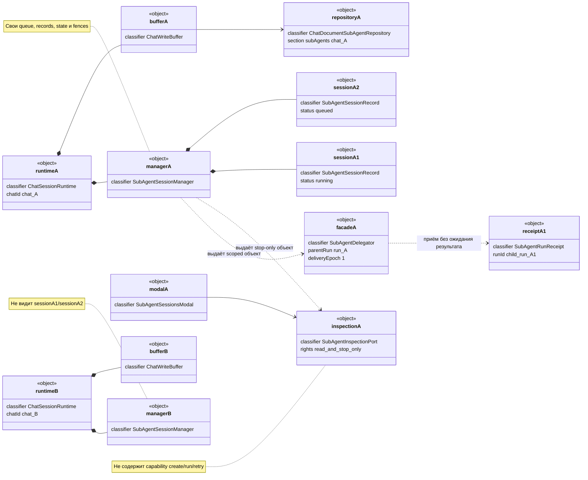

# UML: экземпляры и границы владения

Объектный срез выражен через classDiagram с пометкой object; имена A/B условные.
Строка classifier указывает тип экземпляра. Это иллюстративные ID и количества.
Facade и inspection — разные объекты с разным набором прав, хотя связаны с одним manager.

На этом срезе кнопка чата A показывает 1: running только одна сессия.
При переключении на B без истории кнопка скрыта; modal A закрывается.
Разные секции subAgents и managers не означают обязательные разные экземпляры filesystem client:
общие низкоуровневые stateless зависимости допустимы, состояние детей остаётся изолированным.
Одна session может иметь много последовательных runs, но не два одновременно исполняемых.
