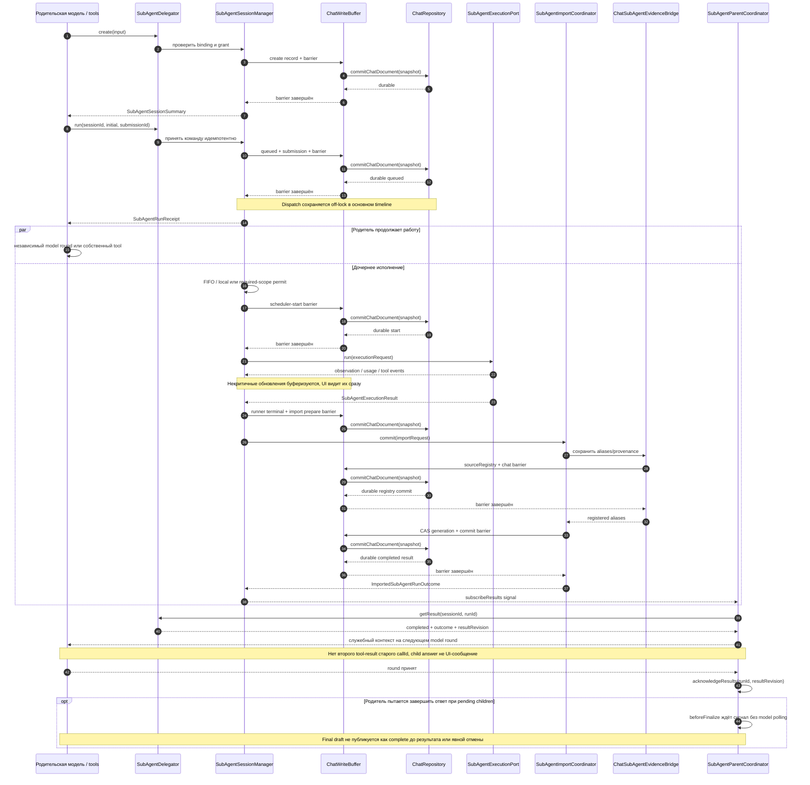
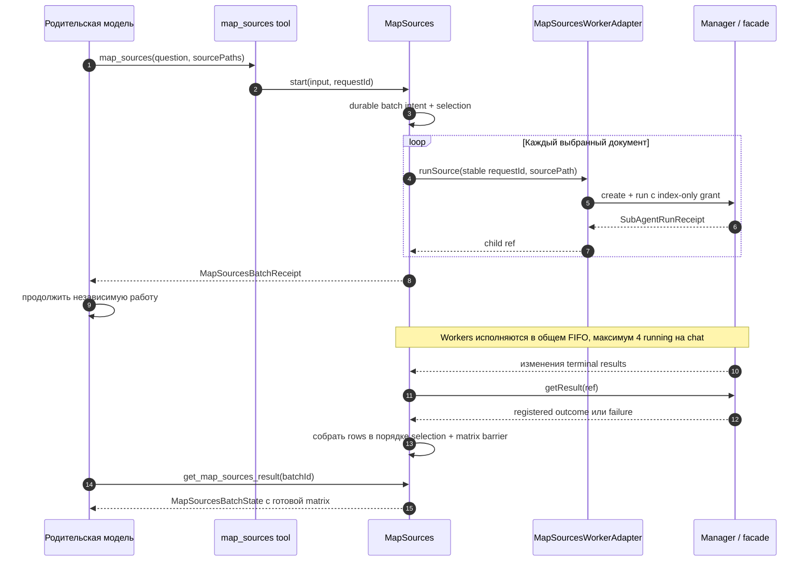

# UML: асинхронная делегация и доставка результата

Участники обозначают роли объектов диаграммы классов. Подписи сообщений описывают
контрактные действия; где нет закреплённого метода, это действие, а не новое имя API.

Один символический save означает успешный обязательный barrier, а не независимую
конкурирующую запись. Manager/chat/budget serializers освобождаются перед внешним await.
При import failure/timeout getResult выдаёт failed/import-failed и будит родителя;
последующий repair публикует новую resultRevision без повторного исполнения агента.

Остановленный worker даёт failed row и не отменяет соседних. До готовности matrix
getResult(batchId) возвращает pending без ожидания workers.
