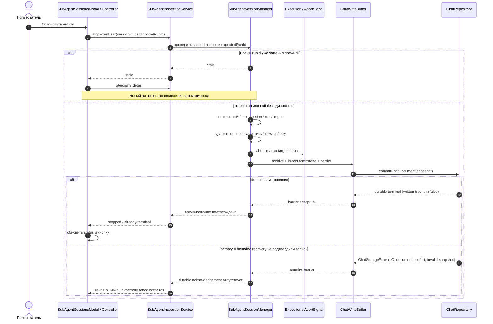
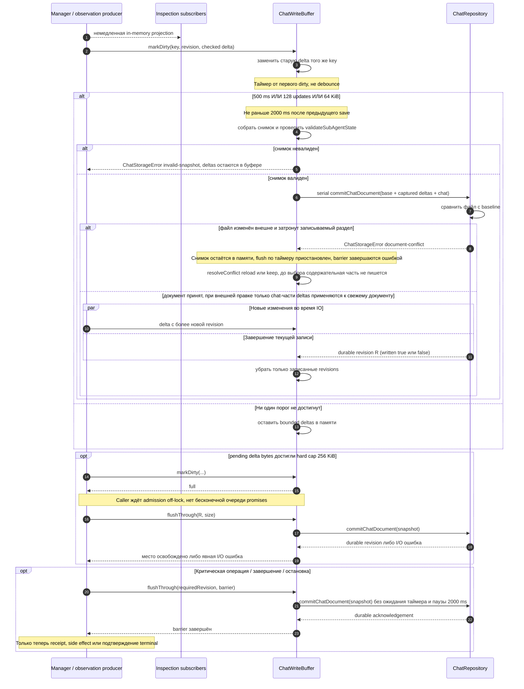

# UML: пользовательская остановка и буфер записи

Источник: шаги 2, 3, 5, 6, 10. Схемы отражают отмену одной сессии и общий буфер записи чата.

controlRunId: active run → pending-import run → последний run → null.
Обычные progress revision не делают stop stale. Если parent terminal уже закрыл сессию,
операция идемпотентно возвращает already-terminal. Modal close не участвует в этой последовательности.

Hard cap считает несохранённые дочерние deltas, не chat-часть и не размер durable истории.
Chat-часть передаётся ChatSessionManager как SaveChatInput по ссылке, сохранение чата — всегда barrier.
Не-barrier flush не начинается раньше 2000 ms после завершения предыдущего save.
Ошибка записи не очищает buffer и не подтверждает revision. Один writer на чат исключает
перезапись новым save старым snapshot. Dispose снимает timer, flush входит в общий deadline
закрытия 2000 ms. Удаление чата вызывает discard(): новые записи отвергаются, запись в полёте
дожидается, при ошибке удаления reopen() возвращает буфер. Это предотвращает воскресание удалённого чата.
