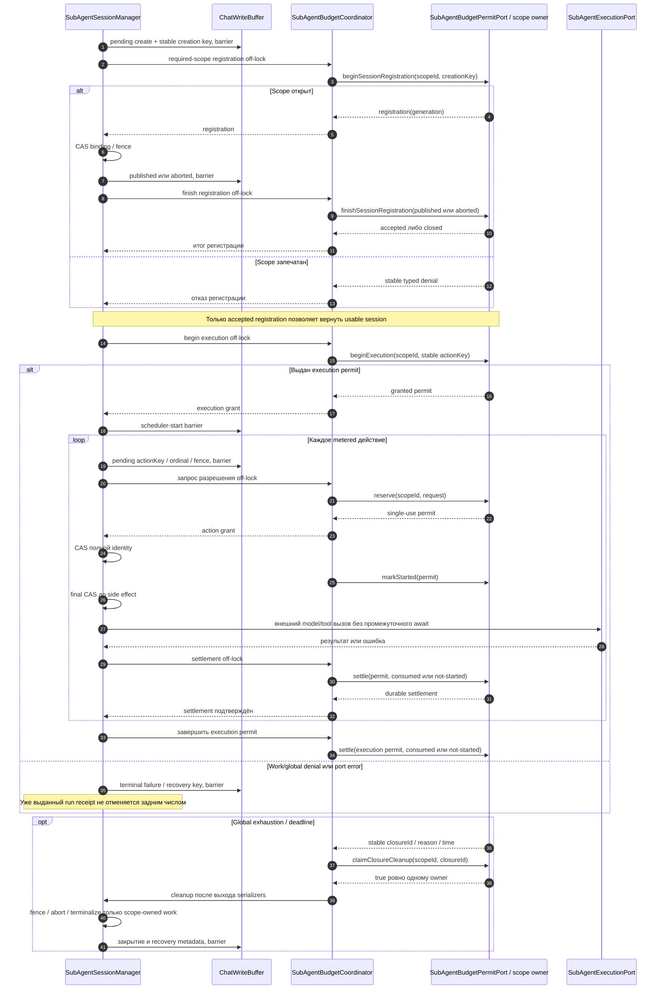

# UML: взаимодействие с владельцем required-scope бюджета

Источник: шаг 4. Owner — внешний объект режима Deep Research; его конкретный класс
не вводится спецификацией sub-agent. В local policy эта ветвь не вызывается.

Ни manager, ни chat serializer не удерживается при await budget port.
Старое разрешение после stop не возобновляет run: unstarted grant возвращается как
not-started; уже started или неопределённое исполнение учитывается как consumed.
Число execution attempts отдельно от model rounds; несколько rounds не создают новых attempts.
При closure новые регистрации запрещены, pre-seal registrations должны завершиться,
и только после durable drain будущий Deep Research может начать verification.
