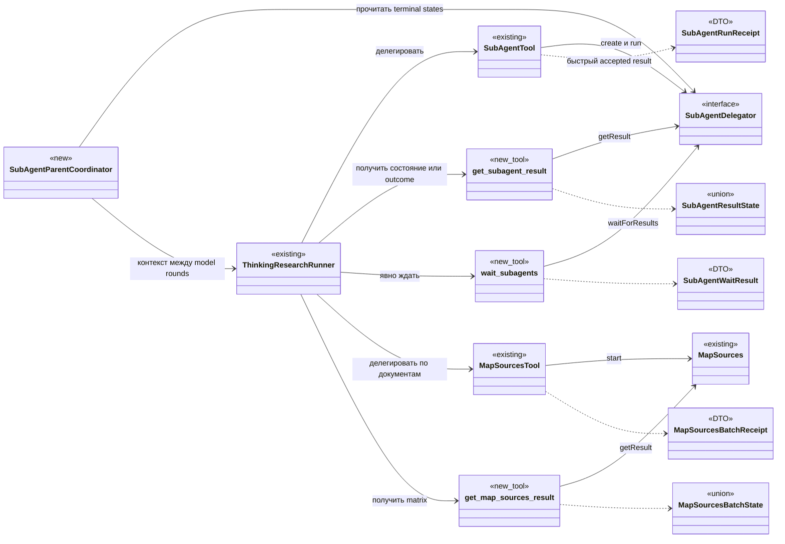

# UML: инструменты родительской модели и асинхронные результаты

Источник: шаги 3, 8, 9. Имена новых tools показаны как функции, существующие tools расширяются.

Запуск не ждёт результата. getResult не исполняет задачу повторно; waitForResults —
ограниченное ожидание подписки, его timeout/cancel не останавливают ребёнка.
Автоматическая доставка не создаёт второй tool-result для уже завершённого launch callId.
Ошибки и repaired результаты различаются по (runId, resultRevision).
Перед доставкой completed outcome SubAgentImportedEvidenceResolver и importRegisteredSnapshot
включают conversation aliases в run registry (шаг 8, диаграмма 01).
